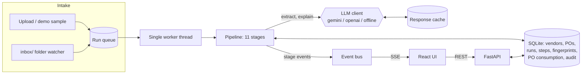

# InvoiceIQ: invoice processing from PDF to decision

InvoiceIQ is a local web app for an accounts-payable clerk. You drop vendor invoice PDFs in, either clean digital PDFs or scans, by uploading them or by placing them in a watched `inbox/` folder that stands in for the AP mailbox. Each invoice becomes a **run** that moves through eleven visible stages and ends in one of three decisions:

- **APPROVE**: matched, within tolerance and scheduled for payment.
- **HOLD FOR REVIEW**: a person must look at it. The app gives the reasons, a suggested next action and, when relevant, a draft email to the vendor.
- **REJECT**: blocked by policy (duplicate, inactive vendor, closed PO).

The design principle: **AI reads the invoice, rules make the decision, and every step is visible.** The LLM extracts fields and writes the plain-English explanation. Deterministic Python rules make the approve/hold/reject call.

## Quick start

Requirements: Linux or macOS, Python 3.10+, Node 18+.

```bash
./setup.sh      # venv, Python + npm deps, UI build, sample invoices, reference data, .env
./run.sh        # http://localhost:8000
```

Everything runs locally as one process on one port. The only network calls are to the LLM provider, and only when a key is configured.

### Adding an API key

Edit `.env` (created from `.env.example` by `setup.sh`):

```
LLM_PROVIDER=gemini        # gemini | openai | offline
LLM_MODEL=gemini-3.8-flash
GEMINI_API_KEY=your-key-here
OPENAI_API_KEY=
```

Restart `./run.sh` after changing it. If the selected provider has no key, the app falls back to the **offline** extractor and says so in the sidebar and on every run. `LLM_PROVIDER=offline` runs without any key. The offline extractor reads digital PDFs with regex and keyword heuristics. For the two bundled scanned samples it replays recorded vision extractions (`backend/tests/fixtures/`). Any other scan gets no fields and is held.

LLM responses are cached under `backend/data/llm_cache/`, keyed by file hash, provider, model and prompt version, so a rehearsed demo does not depend on API latency. You can turn the cache off in Settings.

## Finding codes

Every check reports a code (for example `VENDOR_NOT_FOUND`). The UI shows a plain-English display name instead; [CODES.md](CODES.md) lists every code with its display name, meaning, severity, pipeline stage and effect on the decision.

## Tests and batch run

```bash
source .venv/bin/activate
pytest                                               # unit + end-to-end (offline provider)
python backend/scripts/run_batch.py --provider offline   # all 13 samples vs expected decisions
python backend/scripts/run_batch.py --provider gemini    # same with the real LLM (needs a key)
```

`run_batch.py` **resets runtime data** (runs, PO consumption, fingerprints, audit), processes the samples in filename order and exits non-zero on any mismatch. The expected outcomes live in one place, `EXPECTED` in `backend/scripts/generate_samples.py`.

## Architecture



| Layer | Choice |
|---|---|
| API | FastAPI + Uvicorn, SSE via `StreamingResponse` |
| Storage | SQLite via SQLModel. Money is stored as decimal strings |
| PDF | `pdfplumber` for text and tables, PyMuPDF for rendering scans to PNG |
| LLM | `google-genai` (Gemini, default), `openai`, or the offline heuristic |
| Matching | `rapidfuzz` for vendor names and line descriptions, `python-dateutil` for dates |
| UI | Vite + React 18 + TypeScript + Tailwind + `recharts`, served as static files by FastAPI |

### Pipeline stages

| # | Stage | What it does |
|---|---|---|
| 1 | ingest | SHA-256, type check (fails non-PDFs), copies to `data/uploads/{sha}.pdf`, notes identical earlier files |
| 2 | text_extract | pdfplumber text and tables. Classified as *scanned* if under 80 meaningful chars per page, then pages are rendered at 200 DPI |
| 3 | llm_extract | Structured JSON extraction with Pydantic validation and one retry. Confidence capped at 0.85 for scans, and cut to 0.5 when a cited snippet is not in the text layer |
| 4 | normalise | Invoice number → `INV1001`, PO number → `PO-2026-0102`, dates to ISO, amounts to `Decimal`, tax mode (separate / included / none) and the pre-tax amount |
| 5 | validate | Required fields, arithmetic (lines → subtotal → total, qty × price), confidence threshold, future or stale dates |
| 6 | vendor_match | Tax ID, then fuzzy name/alias. Inactive vendor, bank-detail change (critical), tax ID conflict |
| 7 | po_match | Explicit PO lookup or inference (0.6 × line match + 0.4 × amount fit). Greedy line pairing, quantity vs ordered and received, PO budget |
| 8 | duplicates | Same file, same vendor + normalised number, or near-duplicate. Writes a fingerprint |
| 9 | rules | Unit-price tolerance, total-vs-expected tolerance, auto-approve limit. Snapshots the config |
| 10 | decision | Deterministic policy, next actions, draft vendor email, PO consumption and payment due date |
| 11 | explain | 3–5 sentence explanation (LLM, or a deterministic template offline) |

### Decision policy

| Severity | Examples | Effect |
|---|---|---|
| `block` | `DUPLICATE_INVOICE`, `VENDOR_INACTIVE`, `PO_CLOSED` | **REJECT** |
| `review` | `PO_BUDGET_EXCEEDED`, `BANK_DETAILS_MISMATCH`, `PO_INFERRED`, `PRICE_VARIANCE_EXCEEDS_TOL`, `MISSING_TOTAL`, `VENDOR_NOT_FOUND`, … | **HOLD** |
| `warning` / `info` | `STALE_INVOICE`, `PRICE_VARIANCE_WITHIN_TOL`, `PO_PARTIAL_CONSUMPTION`, `CURRENCY_ASSUMED` | shown, no effect |
| policy list | `never_auto_approve_on` (default: bank change, inferred PO, fuzzy vendor) | forces at least HOLD |

Only APPROVE decisions, and HOLDs a reviewer overrides to approve, consume PO budget, at the pre-tax amount.

## Using the app

- **New Run**: drag in PDFs, or run any of the 13 demo samples. The four headline edge cases (05, 06, 07 and 09) are tagged.
- **Run Detail**: a live stage timeline (SSE, with replay when opened later), the decision card with explanation, next actions and the vendor email draft, approve/reject overrides with a required note, the full check list (passes included), vendor/PO matching with the line-match table and PO budget bar, the PDF, extracted fields with confidence bars, and the audit trail.
- **Dashboard**: stat tiles, decision and finding charts, the filterable runs table, and a needs-attention list of open HOLDs.
- **Reference Data**: vendors (bank account masked) and the PO ledger with consumption and linked invoices.
- **Settings**: tolerances, confidence threshold, auto-approve limit, never-auto-approve codes, demo stage delay, LLM cache, and **Reset demo data**.
- **Email inbox**: copy a PDF into `backend/data/inbox/`. It is picked up once its size is stable across two polls, moved to `inbox/processed/`, and shown with an "Email inbox" badge.

## API

Interactive docs are at `http://localhost:8000/docs`. Main endpoints: `POST /api/runs` (multipart), `POST /api/runs/sample/{file}`, `GET /api/runs`, `GET /api/runs/{id}`, `GET /api/runs/{id}/events` (SSE), `GET /api/runs/{id}/file`, `POST /api/runs/{id}/override`, `POST /api/runs/{id}/rerun`, `GET /api/samples`, `GET /api/stats`, `GET /api/reference/vendors`, `GET /api/reference/pos`, `GET|PUT /api/settings`, `POST /api/system/reset`, `GET /api/health`.

## Project layout

```
backend/app/          FastAPI app, models, settings, event bus, inbox watcher
backend/app/pipeline/ one module per stage + orchestrator (queue worker)
backend/app/llm/      provider protocol, Gemini, OpenAI, offline extractor, cache
backend/data/         reference CSVs, generated samples, uploads, inbox, SQLite DB
backend/scripts/      generate_samples.py, seed.py, run_batch.py
backend/tests/        unit tests per stage + end-to-end over all samples
frontend/             Vite + React UI
```

For development with hot reload, run `uvicorn backend.app.main:app --reload` and `cd frontend && npm run dev`. Vite runs on :5173 and proxies `/api` to :8000.

See [ASSUMPTIONS.md](ASSUMPTIONS.md) for every policy choice and [DEMO_SCRIPT.md](DEMO_SCRIPT.md) for the 5-minute walkthrough.
